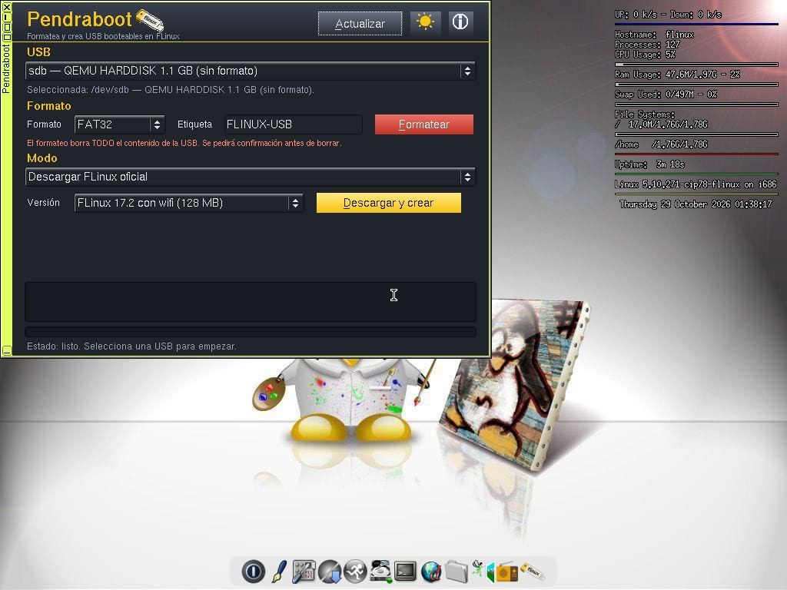
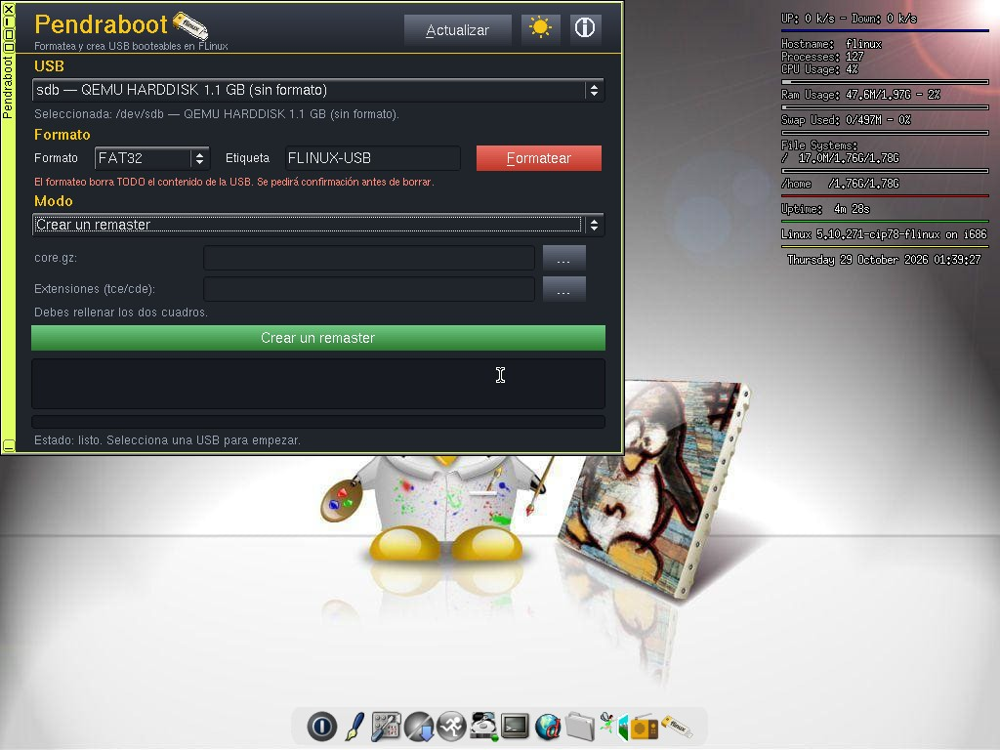
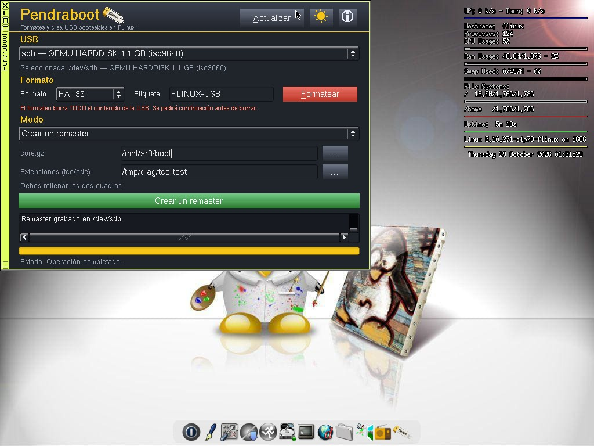

# PendraBoot

Formatea y crea USB booteables en FLinux (32 bits).

## Cómo se hizo

Escrito en C++ con FLTK, compilado dentro de FLinux 17.1 de 32 bits y empaquetado como extensión `.tcz`. Se ejecuta como root (setuid) para poder formatear y grabar dispositivos. Las ISO se hacen híbridas antes de grabarlas, para que la USB arranque escrita en crudo con dd, Rufus o Etcher, y también por Ventoy.

## Funciones

- Ventana compacta (620×460) con desplegable de Modo: solo se ven los controles del modo elegido.
- Detecta solo memorias USB extraíbles: el disco interno nunca aparece en la lista.
- Formatea en FAT32, NTFS y ext4, con etiqueta y confirmación antes de borrar.
- Crea USB booteables de tres formas:
  1. Descargando la ISO oficial de FLinux (con wifi o sin wifi).
  2. Usando una ISO local que ya tengas guardada (sirve cualquier ISO booteable, no solo FLinux).
  3. Creando un remaster de tu sistema instalado.
- El remaster es solo manual: hay que rellenar los dos cuadros, `core.gz:` (archivo core.gz o carpeta boot) y `Extensiones (tce/cde):` (carpeta con `optional/` y `onboot.lst`), con botones `...` para elegir. Si un cuadro está vacío, muestra un error en vez de buscar.
- Modo oscuro (por defecto) y modo claro en gris claro estilo flfm.
- Botón de ayuda con pestañas: Qué es, Cómo se usa (pasos ordenados por lista) y Autores.
- Al instalar, deja su icono en el wbar.

## Imágenes

Ventana principal, modo Descargar:

Modo remaster, con los cuadros manuales:

Remaster completado:

## Créditos

Idea original: Nicolás Longardi, creador de FLinux, que dio la idea en un directo en Kick y con ella inspiró este proyecto. PendraBoot fue desarrollado por Juan Carlos (Juanca) para la comunidad FLinux.

## Instalación

Copiar `pendraboot-1.4.tcz`, `pendraboot-1.4.tcz.dep` y `pendraboot-1.4.tcz.md5.txt` (de la Release) a `tce/optional/`, añadir `pendraboot-1.4` a `onboot.lst` (o `tce-load -i pendraboot-1.4.tcz`) y ejecutar `pendraboot`.

## Estado

Versión 1.4 (prerelease): probada en invitado FLinux 17.1 sin wifi (ventana compacta, cambio de modo, remaster manual completado, error con los cuadros vacíos, desplegable de formato sin btrfs y botones `...`) y en invitado FLinux 17.2 sin wifi (las 3 fotos de arriba). Pendiente: prueba en hardware real, arranque desde USB grabada en máquina real, descarga, formatos y dd de ISO local por GUI, conmutador de tema claro/oscuro en la 1.4 y pestañas «Cómo se usa»/«Autores» de la ayuda.

## Licencia

PendraBoot se distribuye bajo la Licencia Pública General de GNU, versión 3 (GPL-3.0). Ver el archivo `LICENSE`.
