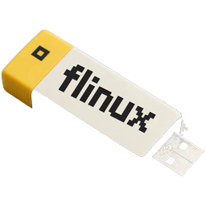
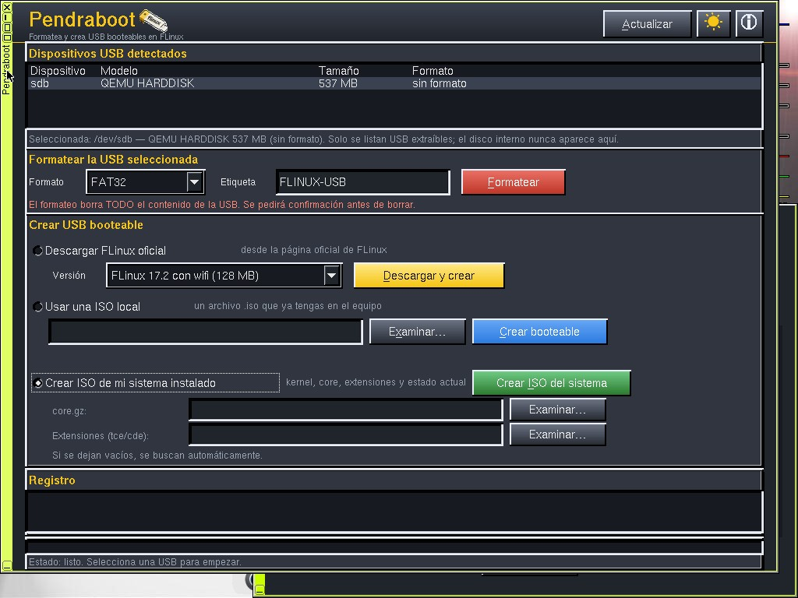
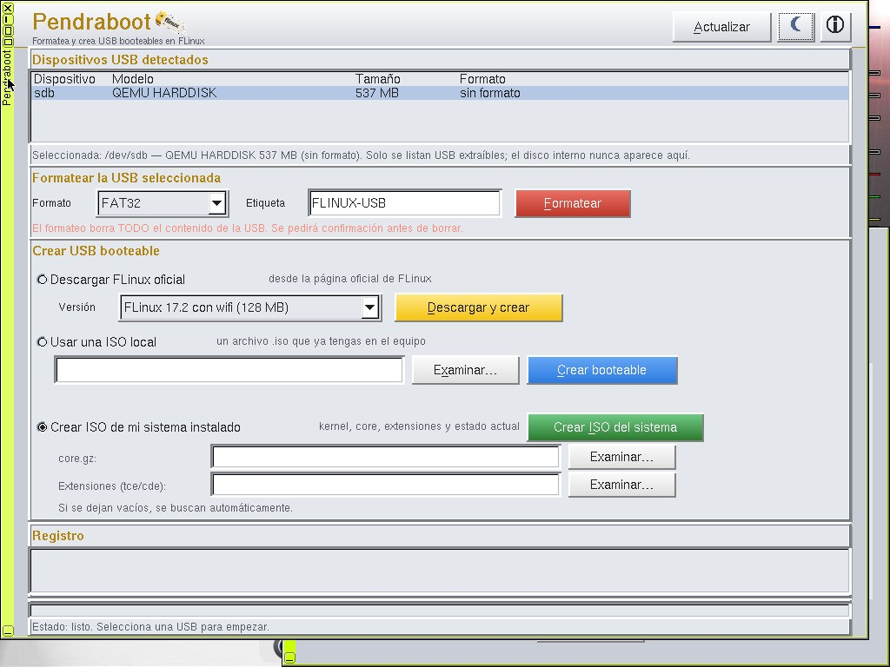
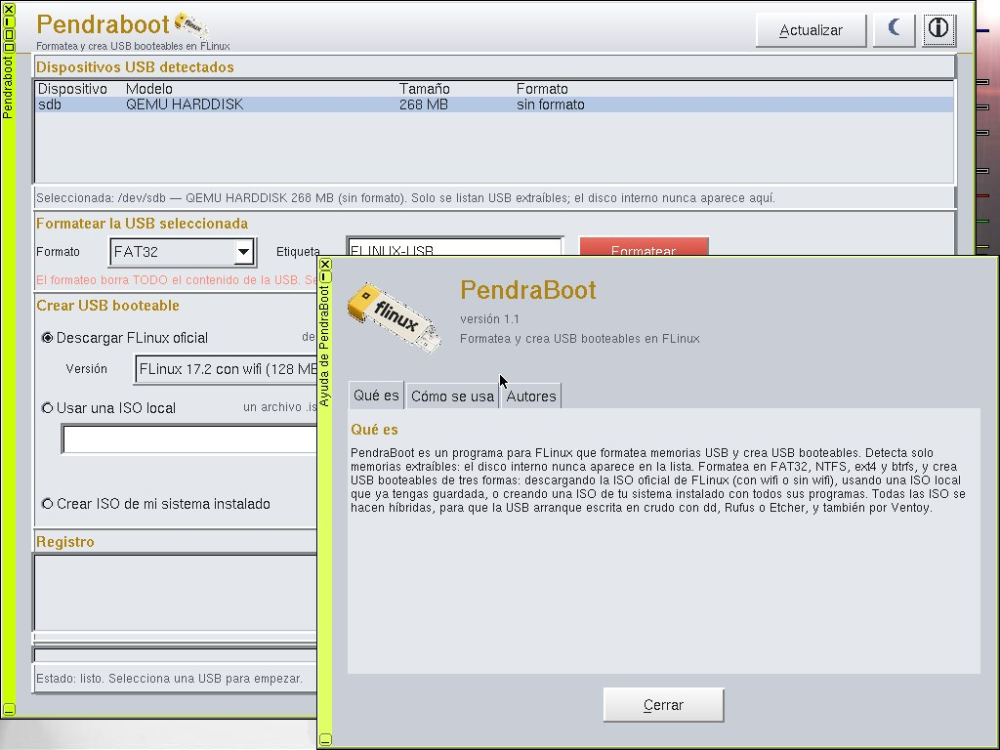
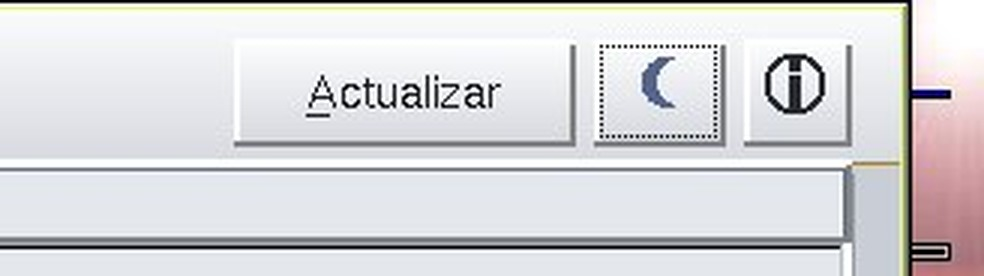

# PendraBoot

Formatea y crea USB booteables en FLinux (32 bits).

## Cómo se hizo

Escrito en C++ con FLTK, compilado dentro de FLinux 17.1 de 32 bits y empaquetado como extensión `.tcz`. Se ejecuta como root (setuid) para poder formatear y grabar dispositivos. Las ISO se hacen híbridas antes de grabarlas, para que la USB arranque escrita en crudo con dd, Rufus o Etcher, y también por Ventoy.

## Funciones

- Detecta solo memorias USB extraíbles: el disco interno nunca aparece en la lista.
- Formatea en FAT32, NTFS, ext4 y btrfs, con etiqueta y confirmación antes de borrar.
- Crea USB booteables de tres formas:
  1. Descargando la ISO oficial de FLinux (con wifi o sin wifi).
  2. Usando una ISO local que ya tengas guardada (sirve cualquier ISO booteable, no solo FLinux).
  3. Creando una ISO de tu sistema instalado, con todos sus programas.
- Modo oscuro (por defecto) y modo claro en gris claro estilo flfm.
- Botón de ayuda con pestañas: Qué es, Cómo se usa y Autores.

## Imágenes

Modo oscuro:

Modo claro:

Ventana de ayuda (versión 1.1):

Cabecera con los iconos centrados:

Icono en el wbar al instalar:

## Créditos

Idea original: Nicolás Longardi, creador de FLinux, que dio la idea en un directo en Kick y con ella inspiró este proyecto. PendraBoot fue desarrollado por Juan Carlos (Juanca) para la comunidad FLinux.

## Instalación

Copiar `pendraboot-1.1.tcz`, `pendraboot-1.1.tcz.dep` y `pendraboot-1.1.tcz.md5.txt` (de la Release) a `tce/optional/`, añadir `pendraboot-1.1` a `onboot.lst` (o `tce-load -i pendraboot-1.1.tcz`) y ejecutar `pendraboot`.

## Estado

Versión 1.1 (prerelease): probada en invitado FLinux 17.1 sin wifi. Pendiente: prueba en hardware real, formatos, dd, descarga y opción 3 completos.

## Licencia

PendraBoot se distribuye bajo la Licencia Pública General de GNU, versión 3 (GPL-3.0). Ver el archivo `LICENSE`.
